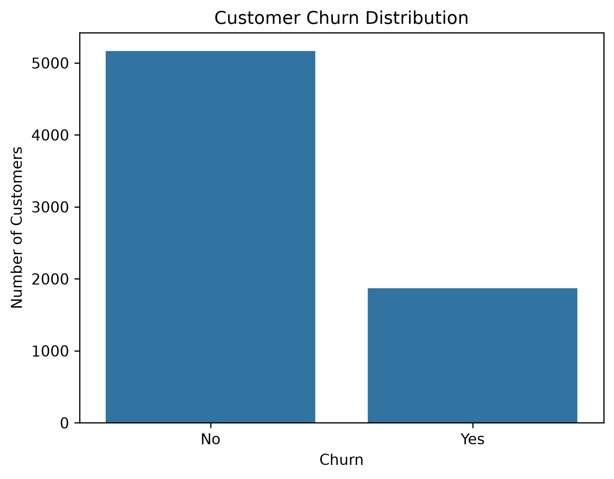
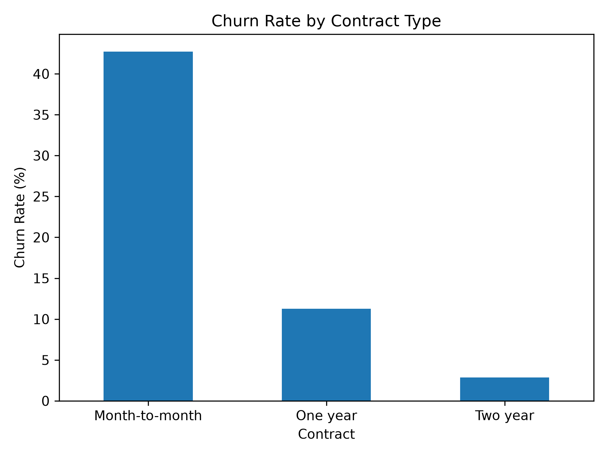
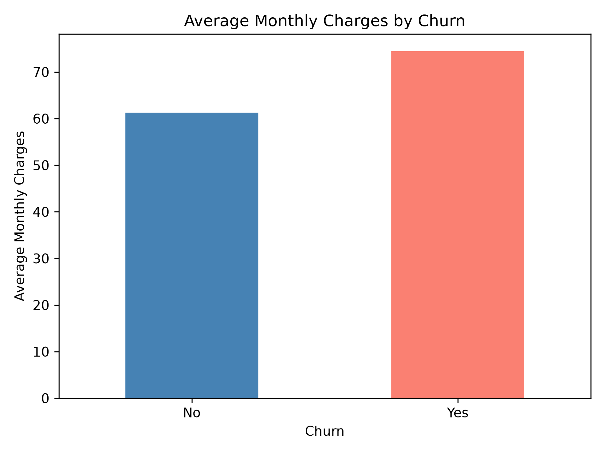
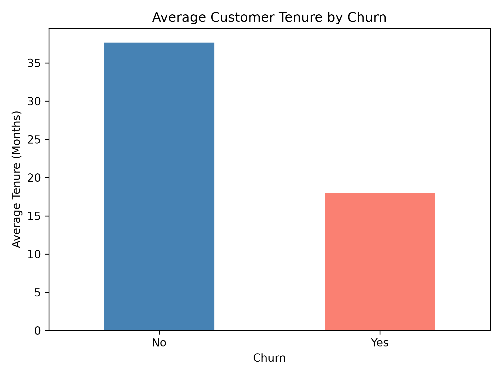
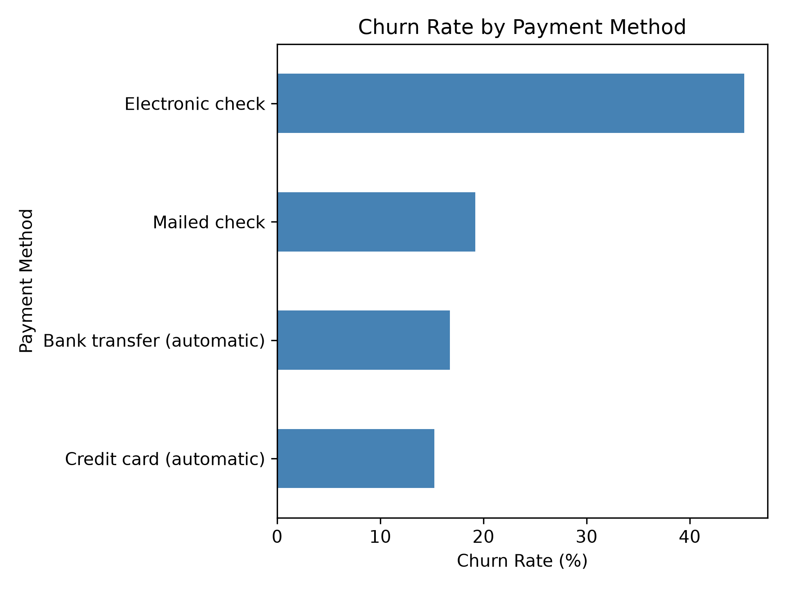
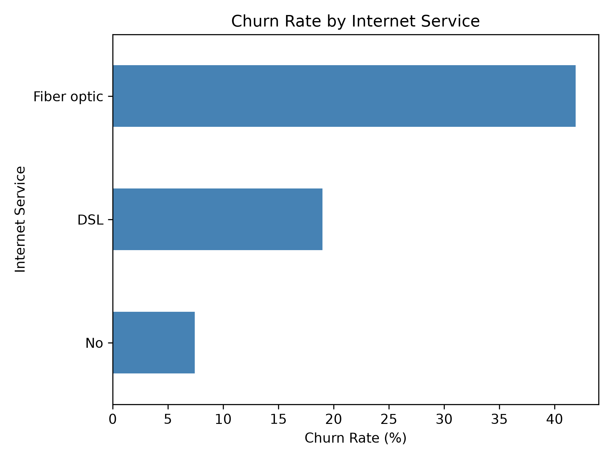

# Customer Churn Analysis with Python

## Project Overview
This project analyzes customer churn in a telecom company using Python, Pandas, and Matplotlib.
The goal is to identify patterns associated with customer churn and provide actionable business insights.

## Dataset
- Source: IBM Telco Customer Churn dataset
- Original records: 7,043
- Cleaned records: 7,032
- Overall churn rate: 26.58%

## Key Findings
- Overall customer churn rate: 26.58%.
- Month-to-month contracts had the highest churn rate (42.71%), compared with one-year (11.28%) and two-year contracts (2.85%).
- Customers who churned had higher average monthly charges (74.44) than those who stayed (61.31).
- Customers who churned had shorter average tenure (17.98 months) than those who stayed (37.65 months).
- Electronic check had the highest churn rate among payment methods (45.29%).
- Fiber optic customers had the highest churn rate among internet service groups (41.89%).

These findings describe associations in the dataset and do not establish causation.

## Visualizations

### Customer Churn Distribution

### Churn Rate by Contract Type

### Average Monthly Charges by Churn

### Average Customer Tenure by Churn

### Churn Rate by Payment Method

### Churn Rate by Internet Service

## How to Run
1. Install Python 3 and clone this repository.
2. Install dependencies: `python -m pip install -r requirements.txt`
3. Run `python 01_data_exploration.py` to prepare the cleaned dataset.
4. Run scripts 02 through 07 to reproduce the analyses and charts.
